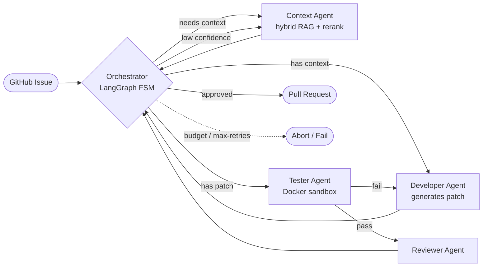

# 🤖 GitHub Issue Resolver — autonomous multi-agent Issue → PR pipeline

An autonomous agent system that takes a GitHub issue, finds the relevant code, writes a fix, tests it in a sandbox, reviews it, and opens a pull request — with a self-correcting retry loop and a hard token budget. Built on **LangGraph** as a multi-agent state machine.

<p align="left">
  
  
  
  
  
  
</p>

---

## Why it's interesting

Most "AI fixes your code" demos are a single prompt. This is the harder, production-shaped version: **specialized agents coordinated by a finite-state graph**, grounded in the real codebase via retrieval, verified in an isolated sandbox, and bounded by explicit cost/retry controls — with tracing and a benchmark to measure whether it actually works.

## Architecture



The **orchestrator** is a router, not a worker: on every tick it checks the token budget and retry count, then routes to whichever agent the current state needs. Context retrieval below a confidence threshold forces a re-query; a failing test sends control back to the developer agent; everything is bounded by `MAX_RETRIES` and `MAX_TOKENS_PER_ISSUE`.

## What each agent does

| Agent | Responsibility |
|---|---|
| **Orchestrator** | LangGraph FSM — routes by state, enforces token budget, retry cap, and confidence gating |
| **Context Agent** | Retrieves relevant code via hybrid search (dense + BM25), reranks top-k, scores confidence |
| **Developer Agent** | Proposes a validated unified-diff patch for the issue |
| **Tester Agent** | Applies the patch in a Docker sandbox, runs tests, classifies failures |
| **Reviewer Agent** | Reviews the passing patch before a PR is opened |

## Key engineering

- **Hybrid RAG over the codebase** — AST-aware chunking with `tree-sitter` (Python / JS / TS / Go), dense embeddings in **Qdrant**, fused with **BM25** (tunable weight), then reranked.
- **Isolated verification** — patches run in a **Docker sandbox** with a pre-warmed container pool and memory / CPU / timeout limits; nothing executes on the host.
- **Self-correction loop** — failing tests feed an error category back to the developer agent for another attempt, up to `MAX_RETRIES`.
- **Cost control** — per-issue token budgeting (`tiktoken`), warn/abort thresholds, and a rate limiter.
- **Reliability** — `tenacity` retries, diff validation before apply, and checkpointing for resumable runs.
- **Observability** — **LangSmith** tracing, **Prometheus** metrics, and structured logs (`structlog`).
- **Evals** — `scripts/evaluate.py` runs the pipeline over a benchmark set and reports resolved rate, first-attempt success, correct-files precision, and latency. CI enforces a **70% coverage** gate.

## Tech stack

`LangGraph` · `langchain-anthropic` / `anthropic` (Claude) · `Qdrant` · `sentence-transformers` + `rank-bm25` · `tree-sitter` · `Docker` · `FastAPI` + `uvicorn` · `PyGithub` · `Prometheus` · `LangSmith` · `pydantic-settings` · `pytest`

## Quickstart

```bash
# 1. Install
pip install -e ".[dev]"

# 2. Configure (copy the template, then fill in YOUR OWN keys)
cp .env.example .env
#    set ANTHROPIC_API_KEY, OPENAI_API_KEY, GITHUB_TOKEN, GITHUB_REPO

# 3. Start Qdrant
docker compose -f docker/docker-compose.yml up -d

# 4. Index a repo, then resolve an issue
indexer                 # build the code index
resolver <issue-number> # run the pipeline
resolver-api            # or serve the FastAPI endpoint

# 5. Evaluate on the benchmark set
evaluate
```

## Project layout

```
src/
  agents/        orchestrator + context / developer / tester / reviewer agents
  indexer/       AST chunking, embedding pipeline, hybrid search
  sandbox/       Docker sandbox manager (pooled, resource-limited)
  observability/ tracing + metrics
  api/           FastAPI server
  utils/         diff validation, rate limiting, token counting, logging
scripts/
  evaluate.py    benchmark harness → evaluation_report.json
```

> ⚠️ **Secrets:** `.env.example` holds placeholders only. Put real keys in `.env` (git-ignored) and never commit them.
